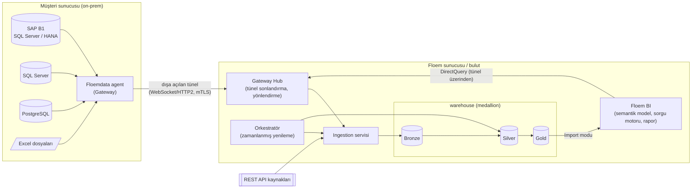

# Floemdata: hedef mimari (agent + warehouse)

> Durum (17.11.2026): `agent/` ve `warehouse/` bu depoda henüz yok. Bu not mevcut kodu
> değil, Floem BI'ın üzerine oturacağı **hedef** Floemdata mimarisini tanımlar.
> Önerilen kütüphaneler ön karardır. Lisans doğrulaması ve son seçim, ilgili repo
> notlarında ve `99-floem-bi-sentez.md` dosyasında kesinleşir.

## 1. Genel resim

## 2. agent (Gateway)

**Rolü:** müşteri ağındaki kaynaklara erişen ve Floem'e yalnızca **dışa doğru** bağlantı
açan ajan. Bu yaklaşım Power BI On-premises Data Gateway'e karşılık gelir.

| Bileşen | Sorumluluk | Aday teknoloji |
|---|---|---|
| Bağlayıcılar (connectors) | Kaynak başına okuma: SQL Server, SAP B1, PostgreSQL, Excel, REST | `pyodbc`/`mssql-python`, `asyncpg` (psycopg3 LGPL olduğu için elendi), `openpyxl`/`calamine`, `httpx` (lisanslar kontrol edilecek) |
| SAP B1 adaptörü | Doğrudan SQL (OINV, INV1, OCRD, OITM, OSLP…) ya da Service Layer (REST/OData). HANA sürümü için `hdbcli` lisansı sorunlu, alternatif aranacak | SQL öncelikli, Service Layer yedek |
| Tünel istemcisi | Gelen port açmadan Floem'e bağlanma, yeniden bağlanma, çoklama | frp/chisel fikirleri (bkz. `frp.md`, `chisel.md`); Python'da WebSocket + HTTP/2 |
| Import çalıştırıcı | Artımlı çekim (watermark: `UpdateDate`/`DocEntry`), parça parça (chunk) aktarım | dlt fikirleri (bkz. `dlt.md`) |
| DirectQuery çalıştırıcı | Floem BI'ın derlediği SQL'i (T-SQL lehçesinde) kaynakta çalıştırıp sonucu döndürme; zaman aşımı, satır limiti, salt okuma kullanıcısı | sqlglot ile lehçe ve güvenlik denetimi |
| Veri taşıma formatı | Kolon bazlı, sıkıştırılmış aktarım | Apache Arrow IPC / Arrow Flight |
| Yönetim | Kayıt (tenant'a bağlama), kimlik bilgilerinin yerelde şifreli saklanması, sağlık durumu, sürüm güncelleme | Yerel şifreli depo; kimlik bilgileri Floem'e gönderilmez |

**Güvenlik ilkeleri:**
- Kaynak kimlik bilgileri müşteri sunucusunda kalır.
- Tünel mTLS ile korunur ve tenant'a özel token kullanılır.
- DirectQuery yalnızca `SELECT` çalıştırır; sqlglot AST denetimi ile DML/DDL reddedilir.
- Kaynakta salt okuma DB kullanıcısı kullanılır.

## 3. warehouse (medallion)

| Katman | İçerik | Biçim | Not |
|---|---|---|---|
| Bronze | Kaynaktan gelen ham kopya ve yükleme metadatası (`_loaded_at`, `_source`, `_tenant_id`) | Parquet (ya da Iceberg/Delta tablo) | Şema evrimine toleranslı, yalnızca ekleme yapılır |
| Silver | Temizlenmiş, tipleri düzeltilmiş, tekilleştirilmiş varlıklar: SAP B1 belge başlığı + satırı, iş ortağı, ürün | Parquet / Iceberg | SAP B1 kod tabloları çözülür, iptal edilen belgeler (`CANCELED='Y'`) işaretlenir |
| Gold | Yıldız şema: `fact_satis` (OINV+INV1, eksi ORIN/RIN1 iadeler), `dim_musteri` (OCRD), `dim_urun` (OITM+OITB), `dim_satis_temsilcisi` (OSLP), `dim_tarih` | DuckDB dosyası veya Parquet + DuckDB | Floem BI semantik modelinin varsayılan kaynağı |

- **Sorgu motoru:** DuckDB, Import modunda VertiPaq'ın yerini alır. Büyük ölçek ve çok kiracılı kullanımda ClickHouse'a geçiş seçeneği açık tutulur (bkz. `90-altyapi.md`).
- **Dönüşüm:** Silver→Gold için SQL modelleri yazılır (dbt-core yaklaşımı ya da yalnızca SQL dosyaları ve bir DAG).
- **Depolama:** yerelde dosya sistemi, ölçeklenince S3 uyumlu nesne depolama (SeaweedFS ya da RustFS).
- **Çok kiracılık:** tenant başına ayrı şema ya da ayrı DuckDB dosyası (fiziksel izolasyon). Gold verisi tenant'lar arasında paylaşılmaz.

## 4. Floem BI'ın bağlanacağı noktalar

1. **Gold katmanı → semantik model (Import modu):** semantik modeldeki tablolar Gold tablolarına eşlenir. Ölçüler DuckDB SQL'ine derlenir.
2. **Gateway → DirectQuery:** ölçü ve filtre isteği T-SQL'e derlenir, tünel üzerinden agent'a gönderilir, sonuç Arrow olarak döner.
3. **Orkestratör → zamanlanmış yenileme:** modelin yenilenmesi Bronze→Silver→Gold zincirini tetikler. Yenileme bitince BI önbelleği geçersiz kılınır.
4. **Metadata:** agent'ın bildirdiği kaynak şeması (tablo/sütun/tip) model editöründe "veri al" ekranını besler. Bu, Power BI Navigator'ın karşılığıdır.
5. **Kimlik ve RLS:** tenant ve kullanıcı kimliği (Keycloak) Floem BI'daki RLS kurallarına aktarılır. RLS her iki modda da derlenen SQL'e `WHERE` koşulu olarak eklenir.

## 5. Eksikler ve açık sorular (sentezdeki "Riskler" bölümüne aktarılacak)

1. SAP B1 sürümü: müşteriler SQL Server sürümünü mü, HANA sürümünü mü kullanıyor? HANA istemci sürücüsünün lisansı ticari dağıtıma uygun mu?
2. Gateway hangi dilde yazılacak: Python mu (mevcut ürünle uyumlu), yoksa tek binary dağıtım için Go mu (frp/chisel)?
3. DirectQuery MVP'ye girecek mi, yoksa ilk sürüm yalnızca Import modu mu olacak?
4. Gold katmanının formatı: tek DuckDB dosyası mı (basit), yoksa Parquet/Iceberg mi (ölçeklenebilir, çok motorlu)?
5. Kiracı izolasyonu: ayrı dosya/şema mı, ayrı süreç/konteyner mi?
6. Artımlı yükleme için SAP B1'de güvenilir değişiklik işaretçisi hangisi (`UpdateDate` + `UpdateTS`, `DocEntry`)? Silme işlemleri nasıl yakalanacak?
