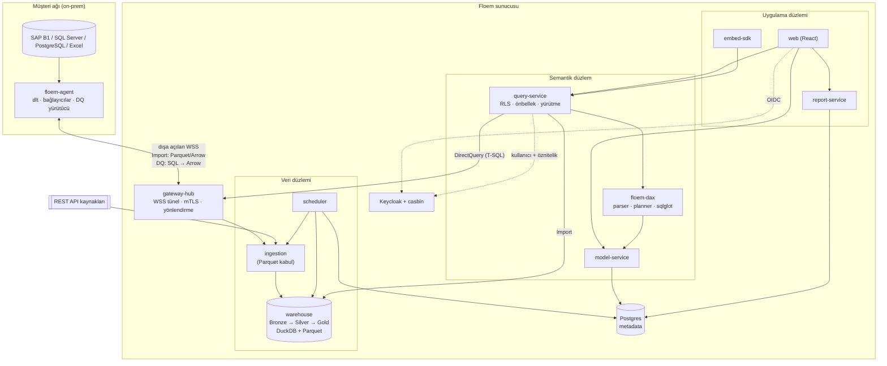

# Floem BI: araştırma sentezi

> Tarih: 17.11.2026.
> Girdi: `research/notes/` altındaki 33 repo notu, `00-floemdata-hedef.md`,
> `90-altyapi.md` ve `91-ux-referanslari.md`. Bölüm başlıkları CLAUDE.md'deki 7 maddeyi izler.
> Kod yazılmadı. Burada geçen SQL'ler tasarım örneğidir ve hiçbir veritabanında
> çalıştırılmadı. Makinede Python olmadığı için sqlglot ile söz dizimi kontrolü de yapılamadı.

## 0. Kısa sonuç

- **Hazır bir çözüm yok.** İncelenen açık kaynak semantik katmanların hiçbirinde DAX'ın
  filtre bağlamı, CALCULATE'in filtre değiştirme mantığı ve ilişki filtre yönü birlikte
  bulunmuyor. Bu katmanlar Rill, MetricFlow, Cube, Lightdash, Malloy, Wren ve
  boring-semantic-layer. Floem BI'ın asıl farkı ve asıl işi, bu üçünü SQL'e derleyen
  çekirdek olacak.
- **Fan-out ve çoklu fact sorunu artık çözülmüş bir problem.** Hepsi aynı şekilde çözüyor:
  her ölçü kendi fact tablosunun grain'inde toplanır, sonra ortak boyutlar üzerinden
  birleştirilir. Örnekler: MetricFlow'da `combine_aggregated_outputs`, Cube'da
  `multiplicationFactor`, Lightdash'te `cte_keys` / `cte_metrics`, boring-semantic-layer'da
  `preagg`, Malloy'da symmetric aggregate. Floem bu deseni benimseyecek.
- **Nesne modeli TOM'dan, derleme hattı MetricFlow ve Cube'dan alınacak.** Nesne modeli
  Power BI kullanıcısının zihin modeline birebir oturduğu için TOM'dan
  (bkz. `TabularEditor.md`). Derleme hattı MetricFlow ve Cube'dan, SQL üretimi sqlglot'tan.
- **Lisans tarafında sürprizler oldu, ama hiçbiri yığını bozmuyor:**
  - MetricFlow yalnızca 0.209 ve sonrasında Apache 2.0.
  - dbt v2 binary'si tescilli.
  - Lightdash'in `ee/` klasörleri kullanılamaz.
  - graphic-walker logo zorunluluğu getiriyor.
  - Superset'in `pymssql` sürücüsü LGPL.
  - psycopg3 LGPL.
  - TabularEditor'ün TOM DLL'leri Microsoft lisanslı.

## 1. Semantik model formatlarının karşılaştırması

| Özellik | Rill metrics view | MetricFlow (dbt SL) | Cube | LookML / Malloy | Tabular / TOM (Power BI) |
|---|---|---|---|---|---|
| Temel birim | Tek tabloya bağlı metrics view | `semantic_model` (entity, dimension, measure) | `cube` (SQL/tablo + measures + dimensions + joins) | `explore`/`view` · Malloy'da `source` | Table, Column, Measure |
| İlişki | Yok (tek tablo) | Entity tipine göre otomatik join, `MAX_JOIN_HOPS=2` | `joins` + `relationship` (one_to_many…) | `join_one`/`join_many` | `Relationship`: kardinalite, `CrossFilteringBehavior`, aktif/pasif |
| Filtre yönü | — | Yok | Yok | Yok | Tek yönlü / çift yönlü |
| Ölçü dili | Ham SQL ifadesi | YAML + Jinja/SQL string, derived/ratio/cumulative | SQL ifadesi + `multi_stage` (`time_shift`, `reduce_by`, `group_by`) | Kendi dili (Malloy), symmetric aggregate | DAX: filtre bağlamı, CALCULATE, iterator |
| Filtre bağlamını değiştirme | Yok | Metrik filtresi yalnızca AND ile ekleniyor | `reduce_by`/`group_by` ile kısmi (ALL benzeri) | Kısmi (`all()`, `exclude()`) | Tam (CALCULATE, ALL, REMOVEFILTERS, KEEPFILTERS…) |
| Zaman zekâsı | Karşılaştırma alt sorgusu | `cumulative`, `offset_window`, time spine | `time_shift`, `rolling_window` | Kısmi | SAMEPERIODLASTYEAR, DATESYTD, DATEADD… |
| Hesaplanmış sütun | Yok | `expr` | SQL dimension | Dimension ifadesi | Calculated column (DAX) |
| Hiyerarşi | Yok | Yok | `hierarchies` (yeni) | Yok | `Hierarchy`/`Level` |
| RLS | Şablonlu `row_filter` | Yok | `queryRewrite` + securityContext | `access_filter` | Rol × tablo DAX filtresi, OLS |
| T-SQL desteği | Yok | Yok | Var | Malloy: deneysel | Kendi motoru (VertiPaq/DQ) |
| Power BI kullanıcısına yakınlık | Düşük | Orta | Orta-yüksek | Düşük (yeni dil) | **Birebir** |

**Değerlendirme:** Power BI kullanıcısının zihin modeline en yakın format tartışmasız
**Tabular/TOM**. Kullanıcı tablo kutularını, ilişki oklarını, ölçüleri ve rolleri zaten
böyle düşünüyor. Diğerlerinden en yakını **Cube**: ilişki kavramı var, `multi_stage`
ölçüleriyle CALCULATE'e en çok yaklaşıyor ve T-SQL üretebiliyor.

Önerilen formül: **TOM nesne modeli + DAX alt kümesi + MetricFlow/Cube tarzı derleme hattı**.
Floem şeması TOM'un özellik adlarını Türkçe arayüzle sunar. JSON/YAML olarak saklanır
(TMDL değil). Power BI'dan geçiş de pbixray ile okunan TMSCHEMA'nın bu şemaya eşlenmesiyle yapılır.

## 2. Floem BI semantik model şeması (taslak)

Saklama formatı YAML, API'de JSON. Şemanın kendisi JSON Schema ile tanımlanacak. vega-lite'ın
TypeScript tiplerinden şema üretme yaklaşımı burada da kullanılabilir. Örnek: SAP B1 satış
modeli, Gold katmanına bağlı.

```yaml
model:
  ad: SAP B1 Satış
  surum: 3                      # model sürümü, her yayınla artar
  kultur: tr-TR
  varsayilan_mod: import        # import | directquery | dual (tablo bazında ezilebilir)

tablolar:
  - ad: Satis                   # olgu tablosu: OINV + INV1 (eksi ORIN + RIN1)
    kaynak: { katman: gold, tablo: fact_satis }
    mod: import
    gizli: false
    sutunlar:
      - { ad: BelgeNo,      kaynak: DocEntry,  tip: int64,   gizli: true }
      - { ad: SatirNo,      kaynak: LineNum,   tip: int64,   gizli: true }
      - { ad: Tarih,        kaynak: DocDate,   tip: date,    gizli: true }
      - { ad: MusteriKodu,  kaynak: CardCode,  tip: string,  gizli: true }
      - { ad: UrunKodu,     kaynak: ItemCode,  tip: string,  gizli: true }
      - { ad: TemsilciKodu, kaynak: SlpCode,   tip: int32,   gizli: true }
      - { ad: Miktar,       kaynak: Quantity,  tip: decimal, ozet: sum, bicim: "#,##0.##" }
      - { ad: Tutar,        kaynak: LineTotal, tip: decimal, ozet: sum, bicim: "#,##0.00 ₺" }
      # hesaplanmış sütun (satır bağlamı, Import modunda materyalize edilir)
      - ad: BirimFiyat
        ifade: "DIVIDE(Satis[Tutar], Satis[Miktar])"
        tip: decimal
    olculer:
      - ad: Toplam Satış
        ifade: "SUM(Satis[Tutar])"
        bicim: "#,##0 ₺"
        klasor: Satış
      - ad: Geçen Yıl Satış
        ifade: "CALCULATE([Toplam Satış], SAMEPERIODLASTYEAR(Tarih[Tarih]))"
        bicim: "#,##0 ₺"
        klasor: Zaman Karşılaştırma
      - ad: Kategori Payı
        ifade: "DIVIDE([Toplam Satış], CALCULATE([Toplam Satış], ALL(Urun[Kategori])))"
        bicim: "0.0%"
        klasor: Oranlar

  - ad: Musteri                 # OCRD (+ OCRG grup adı)
    kaynak: { katman: gold, tablo: dim_musteri }
    sutunlar:
      - { ad: MusteriKodu, kaynak: CardCode, tip: string, anahtar: true }
      - { ad: MusteriAdi,  kaynak: CardName, tip: string }
      - { ad: Grup,        kaynak: GroupName, tip: string }
      - { ad: Sehir,       kaynak: City,     tip: string, veri_kategorisi: city }

  - ad: Urun                    # OITM (+ OITB kategori)
    kaynak: { katman: gold, tablo: dim_urun }
    sutunlar:
      - { ad: UrunKodu, kaynak: ItemCode,   tip: string, anahtar: true }
      - { ad: UrunAdi,  kaynak: ItemName,   tip: string }
      - { ad: Kategori, kaynak: ItmsGrpNam, tip: string }
      - { ad: Marka,    kaynak: FirmName,   tip: string }
    hiyerarsiler:
      - ad: Ürün Hiyerarşisi
        seviyeler: [Kategori, Marka, UrunAdi]

  - ad: Temsilci                # OSLP
    kaynak: { katman: gold, tablo: dim_temsilci }
    sutunlar:
      - { ad: TemsilciKodu, kaynak: SlpCode, tip: int32,  anahtar: true }
      - { ad: TemsilciAdi,  kaynak: SlpName, tip: string }
      - { ad: Eposta,       kaynak: Email,   tip: string, gizli: true }

  - ad: Tarih                   # Floem'in ürettiği tarih tablosu
    kaynak: { uretilen: tarih_tablosu, baslangic: 2018-01-01, bitis: auto }
    tarih_tablosu: { anahtar_sutun: Tarih }     # "Mark as date table" karşılığı
    sutunlar:
      - { ad: Tarih, tip: date, anahtar: true }
      - { ad: Yil,   tip: int32 }
      - { ad: Ceyrek, tip: string }
      - { ad: AyNo,  tip: int32, gizli: true }
      - { ad: Ay,    tip: string, siralama_sutunu: AyNo }   # SortByColumn
    hiyerarsiler:
      - ad: Takvim
        seviyeler: [Yil, Ceyrek, Ay, Tarih]

iliskiler:                       # TOM SingleColumnRelationship karşılığı
  - { kimden: Satis[Tarih],        kime: Tarih[Tarih],           kardinalite: "*:1", filtre_yonu: tek,  aktif: true }
  - { kimden: Satis[MusteriKodu],  kime: Musteri[MusteriKodu],   kardinalite: "*:1", filtre_yonu: tek,  aktif: true }
  - { kimden: Satis[UrunKodu],     kime: Urun[UrunKodu],         kardinalite: "*:1", filtre_yonu: tek,  aktif: true }
  - { kimden: Satis[TemsilciKodu], kime: Temsilci[TemsilciKodu], kardinalite: "*:1", filtre_yonu: tek,  aktif: true }
    # filtre_yonu: tek | cift ; referans_butunlugu: true → INNER JOIN kullanılabilir (RelyOnReferentialIntegrity)

roller:                          # RLS: rol × tablo filtresi (DAX boolean ifadesi)
  - ad: Satış Temsilcisi
    uyeler: { keycloak_grubu: satis-temsilcileri }
    tablo_izinleri:
      - tablo: Temsilci
        filtre: "Temsilci[Eposta] = USERPRINCIPALNAME()"
  - ad: Bölge Müdürü
    tablo_izinleri:
      - tablo: Musteri
        filtre: "Musteri[Sehir] IN USERATTRIBUTE(\"sehirler\")"   # Keycloak kullanıcı özniteliği
    sutun_izinleri:              # OLS
      - { sutun: Satis[BirimFiyat], izin: yok }
```

**Notlar:**
- Özellik adları TOM'dan alındı (`TabularEditor.md`). Örnekler: `SummarizeBy` → `ozet`,
  `SortByColumn` → `siralama_sutunu`, `CrossFilteringBehavior` → `filtre_yonu`.
  Ayrıntılı eşleme listesi o notta.
- Sabit alanların İngilizce adı da şemada tutulacak (`name`/`ad` takma adı), böylece API
  dil bağımsız olur.
- `USERATTRIBUTE()` bir Floem uzantısı. Grist'in `UserAttributeRule` fikri ile Lightdash'in
  `${lightdash.attributes.x}` fikrinin birleşimi.
- Model bağımlılık grafiği (ölçü → ölçü/sütun) her kayıtta yeniden kurulur. Döngüsel
  bağımlılık kayıt sırasında reddedilir. TabularEditor bunu yalnızca arayüzde gösteriyordu.
  Grafik, grist `depend.py` ve TabularEditor `DependencyList` desenleriyle kurulur.

## 3. Floem DAX: SQL derleme tasarımı

### 3.1 Parser kararı: sıfırdan yazılacak (Python)

| Seçenek | Değerlendirme |
|---|---|
| pbi_parsers'ı fork etmek | **Hayır.** İkili operatörlerin hepsi sağdan gruplanıyor (`1-2-3` → `2`). Lexer kelime sınırına bakmıyor (`VAR.P`, `Returns[...]` bozuluyor). Hata kurtarma yok. Sorunlar tasarımdan geliyor, yamayla düzelmez (`pbi_parsers.md`). |
| PyDAXLexer / TabularEditor ANTLR | **Yalnızca kaynak olarak.** Repoda yalnızca lexer grameri var, parser grameri yok. PyDAXLexer küçük harfli fonksiyonları tanımıyor. |
| ANTLR ile kendi gramerimiz | Mümkün, ama editördeki anlık hata kurtarma ve kaynak konumu takibi el yazımı parser kadar esnek değil. |
| **El yazımı lexer ve Pratt parser** | **Seçildi.** Yaklaşık 1.500–2.500 satır Python. Tam kontrol, iyi hata mesajı, kısmi AST. |

**Alınacaklar:**
- Token ve fonksiyon listesi TabularEditor `DAXLexer.g4` dosyasından (MIT, atıf ile).
  Yaklaşık 392 anahtar kelime var. Bunlara `MATCHBY`, `INFO.*` ve visual calculation
  fonksiyonları eklenecek.
- `TextSlice`/`Span` ile kaynak konumu takibi ve `highlight_section` ile hata gösterimi
  fikri pbi_parsers'tan.
- Test korpusu: PyDAXLexer `resources/` altındaki yaklaşık 100 gerçek ölçü ve pbi_parsers'taki
  DAX tuhaflıkları listesi.
- İç içe ifadeler için Lightdash `packages/formula` (Peggy grameri → AST → lehçe) küçük bir
  referans.

**Derleme aşamaları:**

```
metin ─► Lexer ─► Parser (Pratt) ─► AST (+Span)
      ─► Binder: [X] → ölçü mü sütun mu? Tablo[Sütun] çözümü, tip çıkarımı, VAR kapsamı
      ─► Semantik IR (ölçü ağacı: Aggregate, Calculate(filtre değiştiriciler), Divide, ...)
      ─► Sorgu planlayıcı (görsel bağlamı + RLS + ölçüler → mantıksal plan)
      ─► SQL üretici: sqlglot exp.* AST
      ─► lehçe render: duckdb | tsql (| postgres | clickhouse)
```

### 3.2 Filtre bağlamının temsili

Görsel bir sorgu gönderir: seçilen boyut sütunları, ölçüler, slicer/sayfa/rapor
filtreleri ve kullanıcının rolü. Planlayıcı bu sorguyu bir `FilterContext` nesnesine çevirir:

```python
FilterContext = {
  "gruplama": [Tarih.Yil, Urun.Kategori],          # satır/sütun bağlamı (görselin eksenleri)
  "filtreler": {                                    # sütun → predicate kümesi
     Musteri.Grup: In(["Bayi"]),                    # slicer
  },
  "rls": [Temsilci.Eposta == "ali@firma.com"],      # her zaman eklenir, CALCULATE ile kaldırılamaz
}
```

CALCULATE bu bağlamı dönüştüren saf bir fonksiyondur:

| DAX | `FilterContext` dönüşümü |
|---|---|
| `CALCULATE(m, Urun[Kategori] = "A")` | `filtreler[Urun.Kategori]` **değiştirilir** (eski filtre atılır) |
| `KEEPFILTERS(...)` | Mevcut filtreyle **kesişim** |
| `ALL(Urun[Kategori])` / `REMOVEFILTERS` | `Urun.Kategori` hem `filtreler`den hem `gruplama`dan çıkarılır |
| `ALL(Urun)` | `Urun` tablosunun bütün sütunları çıkarılır |
| `ALLEXCEPT(Urun, Urun[Marka])` | `Urun`'un Marka dışındaki sütunları çıkarılır |
| `SAMEPERIODLASTYEAR(Tarih[Tarih])` | Tarih tablosundaki filtre ve gruplama **kaydırma ilişkisiyle** yeniden yorumlanır (3.4) |
| `USERELATIONSHIP(a, b)` | O alt sorgu için pasif ilişki aktif, rakip ilişki pasif yapılır |
| `CROSSFILTER(a, b, Both)` | O alt sorgu için filtre yönü değiştirilir |

Her farklı (ölçü, `FilterContext`) çifti **bir alt sorgu** (CTE) olur. Aynı bağlamı paylaşan
ölçüler aynı CTE'de toplanır. Ardından CTE'ler ortak gruplama sütunları üzerinden
`LEFT JOIN` ile birleştirilir. Bu MetricFlow'daki `combine_aggregated_outputs` ve Cube'daki
`multi_stage` deseninin aynısı.

Filtreler ilişki yönünde yayılır:
- **Tek yön (1 → \*):** boyut filtresi, fact tablosuna JOIN ve WHERE ile uygulanır.
- **Çift yön:** fact üzerinden karşı boyuta semi-join (`EXISTS`) ile uygulanır.
- **Fan-out:** her ölçü kendi fact tablosunun grain'inde toplanır, sonra birleştirilir.
  Join yolu MetricFlow'daki entity kuralları gibi doğrulanır: `*:1` yönünde serbest,
  `1:*` yönünde ölçü önce toplanır.

**İlk sürümde (MVP) desteklenecek DAX alt kümesi:**
- Toplama fonksiyonları: SUM, AVERAGE, MIN, MAX, COUNT, COUNTROWS, DISTINCTCOUNT.
- Hesaplama ve mantık: DIVIDE, aritmetik ve karşılaştırma, IF, SWITCH, VAR/RETURN.
- Bağlam değiştirme: CALCULATE, ALL, REMOVEFILTERS, KEEPFILTERS, ALLEXCEPT.
- Zaman zekâsı: SAMEPERIODLASTYEAR, DATEADD, DATESYTD/TOTALYTD, DATESMTD.
- Satır satır hesaplayan fonksiyonlar (SUMX vb.) yalnızca tek tablo üzerinde ve basit
  ifadelerle; satır bazlı ifade SQL'deki `SUM(expr)`'e çevrilir.

Desteklenmeyen fonksiyon kullanılırsa derleyici, Span ile birlikte anlaşılır bir hata verir.
sqlglot da `unsupported_level=RAISE` ile çalışır.

### 3.3 Örnek sorgu bağlamı

Tablo/Matrix görseli şöyle kurulu:
- **Satırlar:** `Tarih[Yil]`, `Urun[Kategori]`
- **Değerler:** üç ölçü
- **Slicer:** `Musteri[Grup] = "Bayi"`
- **RLS:** yok (sade örnek)

Gold tabloları: `gold.fact_satis`, `gold.dim_tarih`, `gold.dim_urun`, `gold.dim_musteri`.
Ayrıca model yenilenirken `gold.tarih_kaydirma_yil` üretilir (bkz. 3.4).

### 3.4 Zaman zekâsının karşılığı: kaydırma tablosu

DAX'taki `SAMEPERIODLASTYEAR`, filtre bağlamındaki tarih kümesini bir yıl geri kaydırır.
Ayın son günü kuralı da vardır: 28.02.2025 bağlamı, 29.02.2024'ü de kapsar.

SQL'de bunu her lehçede aynı şekilde yapmak için tarih tablosu yenilenirken bir
**kaydırma tablosu** üretilir. Her `Tarih` için hangi `KaynakTarih`lerin "geçen yılın aynı
dönemi" sayıldığını tutar:

| Tarih | KaynakTarih | Kural |
|---|---|---|
| 2025-03-15 | 2024-03-15 | Normal gün: bir yıl öncesi |
| 2025-02-28 | 2024-02-28, 2024-02-29 | Ayın son günü: hedef aydaki karşılığından ay sonuna kadar tüm günler |
| 2024-02-29 | 2023-02-28 | Ayın son günü → hedef ayın son günü |
| 2024-02-28 | *(boş)* | Ayın son günü değil ve gün ≥ hedef ayın gün sayısı: 2023-02-28 zaten 29.02 üzerinden eşli, çift sayımı önler |

Genel kural (her ay kaydırması için, `src/floem_bi/compiler/timeintel.py`):
- Ayın son günü, hedef aydaki karşılığından ay sonuna kadar tüm günlere eşlenir.
- Diğer günler aynı güne eşlenir. Ancak gün sayısı hedef ayın gün sayısına eşit veya
  ondan büyükse eşleme boş kalır.

Bu tablo yıl, çeyrek ve ay gibi tam dönem bağlamlarında DAX ile aynı sonucu verir ve hiçbir
kaynak günü iki kez saymaz (`tests/test_timeintel.py`). Bilinen sapma: yalnızca 28.02.2024
gününü içeren tek günlük bir bağlamda DAX 28.02.2023'ü döndürür, bu tablo ise boş döndürür. `DATEADD(..., -1, MONTH)`,
`PARALLELPERIOD` ve `DATESYTD` için de aynı mantıkla ayrı kaydırma veya kapsama tabloları
üretilir. Cube'daki `time_shift` ve MetricFlow'daki time spine fikirlerinin genelleştirilmiş hali.

### 3.5 Üç ölçü için üretilecek SQL

**DuckDB (Import modu):**

```sql
WITH
q_toplam AS (               -- [Toplam Satış] | bağlam: Yil × Kategori, Grup = 'Bayi'
  SELECT t.Yil, u.Kategori, SUM(s.Tutar) AS toplam_satis
  FROM gold.fact_satis AS s
  JOIN gold.dim_tarih   AS t ON t.Tarih = s.Tarih
  JOIN gold.dim_urun    AS u ON u.UrunKodu = s.UrunKodu
  JOIN gold.dim_musteri AS m ON m.MusteriKodu = s.MusteriKodu
  WHERE m.Grup = 'Bayi'
  GROUP BY t.Yil, u.Kategori
),
q_gecen_yil AS (            -- CALCULATE([Toplam Satış], SAMEPERIODLASTYEAR(Tarih[Tarih]))
  SELECT t.Yil, u.Kategori, SUM(s.Tutar) AS gecen_yil_satis
  FROM gold.fact_satis AS s
  JOIN gold.tarih_kaydirma_yil AS k ON k.KaynakTarih = s.Tarih   -- fact tarihi → kaynak
  JOIN gold.dim_tarih   AS t ON t.Tarih = k.Tarih                -- bağlam tarihi
  JOIN gold.dim_urun    AS u ON u.UrunKodu = s.UrunKodu
  JOIN gold.dim_musteri AS m ON m.MusteriKodu = s.MusteriKodu
  WHERE m.Grup = 'Bayi'
  GROUP BY t.Yil, u.Kategori
),
q_payda AS (                -- CALCULATE([Toplam Satış], ALL(Urun[Kategori])) → Kategori gruplaması kalkar
  SELECT t.Yil, SUM(s.Tutar) AS toplam_satis_tum_kategori
  FROM gold.fact_satis AS s
  JOIN gold.dim_tarih   AS t ON t.Tarih = s.Tarih
  JOIN gold.dim_musteri AS m ON m.MusteriKodu = s.MusteriKodu
  WHERE m.Grup = 'Bayi'
  GROUP BY t.Yil
),
eksen AS (                  -- en az bir ölçüsü boş olmayan satırlar (DAX'ın boş satır gizleme kuralı)
  SELECT Yil, Kategori FROM q_toplam
  UNION
  SELECT Yil, Kategori FROM q_gecen_yil
)
SELECT
  e.Yil,
  e.Kategori,
  a.toplam_satis                                  AS "Toplam Satış",
  b.gecen_yil_satis                               AS "Geçen Yıl Satış",
  a.toplam_satis / NULLIF(c.toplam_satis_tum_kategori, 0) AS "Kategori Payı"   -- DIVIDE: 0 → BLANK
FROM eksen AS e
LEFT JOIN q_toplam    AS a USING (Yil, Kategori)
LEFT JOIN q_gecen_yil AS b USING (Yil, Kategori)
LEFT JOIN q_payda     AS c USING (Yil)
ORDER BY e.Yil, e.Kategori;
```

**T-SQL (DirectQuery, Gateway üzerinden SQL Server'da çalışır):**

Gold katmanı DirectQuery'de kaynakta bulunmaz. Bu yüzden tablo adları semantik modeldeki
`kaynak` eşlemesinden gelir. Örnekte kolaylık için kaynakta `dbo` altında aynı adlarla görünüm
olduğu varsayıldı. Kaydırma tablosu DirectQuery için kaynağa yazılamıyorsa iki yol var:
`VALUES` ile satır içi gömülür ya da çapraz sorgu sınırı olarak işaretlenip Import moduna
düşülür. Bu kararı açık soru 6'ya bıraktım.

```sql
WITH
q_toplam AS (
  SELECT t.[Yil], u.[Kategori], SUM(s.[Tutar]) AS toplam_satis
  FROM dbo.fact_satis AS s
  INNER JOIN dbo.dim_tarih   AS t ON t.[Tarih] = s.[Tarih]
  INNER JOIN dbo.dim_urun    AS u ON u.[UrunKodu] = s.[UrunKodu]
  INNER JOIN dbo.dim_musteri AS m ON m.[MusteriKodu] = s.[MusteriKodu]
  WHERE m.[Grup] = N'Bayi'
  GROUP BY t.[Yil], u.[Kategori]
),
q_gecen_yil AS (
  SELECT t.[Yil], u.[Kategori], SUM(s.[Tutar]) AS gecen_yil_satis
  FROM dbo.fact_satis AS s
  INNER JOIN dbo.tarih_kaydirma_yil AS k ON k.[KaynakTarih] = s.[Tarih]
  INNER JOIN dbo.dim_tarih   AS t ON t.[Tarih] = k.[Tarih]
  INNER JOIN dbo.dim_urun    AS u ON u.[UrunKodu] = s.[UrunKodu]
  INNER JOIN dbo.dim_musteri AS m ON m.[MusteriKodu] = s.[MusteriKodu]
  WHERE m.[Grup] = N'Bayi'
  GROUP BY t.[Yil], u.[Kategori]
),
q_payda AS (
  SELECT t.[Yil], SUM(s.[Tutar]) AS toplam_satis_tum_kategori
  FROM dbo.fact_satis AS s
  INNER JOIN dbo.dim_tarih   AS t ON t.[Tarih] = s.[Tarih]
  INNER JOIN dbo.dim_musteri AS m ON m.[MusteriKodu] = s.[MusteriKodu]
  WHERE m.[Grup] = N'Bayi'
  GROUP BY t.[Yil]
),
eksen AS (
  SELECT [Yil], [Kategori] FROM q_toplam
  UNION
  SELECT [Yil], [Kategori] FROM q_gecen_yil
)
SELECT
  e.[Yil],
  e.[Kategori],
  a.toplam_satis    AS [Toplam Satış],
  b.gecen_yil_satis AS [Geçen Yıl Satış],
  CAST(a.toplam_satis AS DECIMAL(38, 12))
    / NULLIF(CAST(c.toplam_satis_tum_kategori AS DECIMAL(38, 12)), 0) AS [Kategori Payı]
FROM eksen AS e
LEFT JOIN q_toplam    AS a ON a.[Yil] = e.[Yil] AND a.[Kategori] = e.[Kategori]
LEFT JOIN q_gecen_yil AS b ON b.[Yil] = e.[Yil] AND b.[Kategori] = e.[Kategori]
LEFT JOIN q_payda     AS c ON c.[Yil] = e.[Yil]
ORDER BY e.[Yil], e.[Kategori];
```

**Lehçe farkları (sqlglot'un üstleneceği kısım):**
- Tanımlayıcı tırnaklama: DuckDB'de `"..."`, T-SQL'de `[...]`.
- Unicode literal: T-SQL'de `N'...'`.
- `USING` T-SQL'de yok; `ON` ile açılır.
- T-SQL'de decimal bölme ölçeği küçülür; `CAST(... AS DECIMAL(38,12))` eklenir.
- `NULL` sıralaması iki motorda farklı; gerekirse açıkça `NULLS LAST` yazılır.

**Optimizasyon:** `q_payda` aynı filtreleri paylaşıyor ve gruplaması `q_toplam`'ın alt kümesi.
Bu yüzden optimizer onu pencere fonksiyonuna indirebilir:
`SUM(SUM(s.Tutar)) OVER (PARTITION BY t.Yil)`. Böylece fact tablosu bir kez az taranır.
Bu kural MetricFlow'un O0–O5 optimizasyon geçişleri gibi ayrı bir aşama olarak eklenecek.
Testlerde hem optimize edilmiş hem ham hal golden SQL olarak sabitlenir (Lightdash yaklaşımı).

**Toplam satırı:** Matrix'te alt toplam ve genel toplam satırları, DAX'ta olduğu gibi ölçünün
o bağlamda **yeniden hesaplanmasıyla** bulunur, satırların toplanmasıyla değil. SQL'de bunun
iki yolu var:
- Her toplam seviyesi için aynı planı daha az gruplama sütunuyla yeniden üretmek.
- Toplanabilir ölçülerde `GROUPING SETS` kullanmak (evidence ve perspective deseni).

`Kategori Payı` gibi oranların toplamı mutlaka yeniden hesaplanmalı. TanStack Table'ın
tarayıcıda toplama yapması bu ölçüler için yanlış sonuç verir.

## 4. Floem BI mimarisi

### 4.1 Modüller

| # | Modül | Sorumluluk | Teknoloji | Gerekçe |
|---|---|---|---|---|
| 1 | **floem-agent** (Gateway ajanı) | Bağlayıcılar, artımlı çekim, DirectQuery yürütme, tünel istemcisi | Python, dlt (`sql_database`), pyodbc/mssql-python, asyncpg, openpyxl, httpx, websockets, pyarrow | Mevcut Floemdata ekosistemi Python. dlt artımlı çekimi tek başına karşılıyor. Ajan Parquet yazar, hedef DB kimlik bilgisi taşımaz. |
| 2 | **gateway-hub** | WSS tünelini sonlandırma, tenant/ajan kaydı, istek yönlendirme, mTLS | Python (ASGI) + WebSocket üzerinde çoklanmış kendi protokolümüz | frp/chisel'den kontrol kanalı ve work-conn fikri alınır. Ham TCP yerine "sorgu ajanda çalışır, yalnızca Arrow sonuç döner" modeli kullanılır. |
| 3 | **warehouse** | Bronze, Silver ve Gold katmanları, dönüşümler, tarih ve kaydırma tabloları, snapshot | DuckDB + Parquet, SQL dönüşümler (dbt benzeri `ref()` DAG, kendi küçük çalıştırıcımız) | dbt v2 SQL Server desteklemiyor ve binary'si tescilli. Dagster on-prem için ağır. |
| 4 | **scheduler** | Zamanlanmış yenileme, bağımlılık zinciri, yeniden deneme | Python, Postgres'te iş tablosu ve hafif bir zamanlayıcı | Dagster'ın asset ve `on_cron` modeli referans alınır. Redash'ten `2**n` geri çekilme ve aynı işi çift çalıştırmayı önleyen kilit. |
| 5 | **model-service** | Semantik model CRUD, sürümleme, doğrulama, bağımlılık grafiği, pbixray ile `.pbix` içe aktarma | Python (FastAPI), Postgres (metadata), JSON Schema | TOM şeması (bölüm 2). |
| 6 | **floem-dax** (kütüphane) | Lexer, Pratt parser, binder, semantik IR, planlayıcı, SQL üretimi | Saf Python + sqlglot | Bölüm 3. Hiçbir servise bağlı olmayan, saf, test edilebilir çekirdek. |
| 7 | **query-service** | Görsel sorgusu → `floem-dax` → SQL. RLS ekleme, önbellek, DuckDB veya DirectQuery yürütme, Arrow yanıt | Python (FastAPI), DuckDB (snapshot başına salt okuma bağlantısı), Arrow IPC | Superset `SemanticQuery` sözleşmesi örnek alınır. Önbellek anahtarı = normalize SQL + tenant + RLS bağlamı. Redash'teki eksiklik böylece giderilir. |
| 8 | **report-service** | Rapor/dashboard JSON (sayfa, görsel, layout), sürüm, paylaşım, embed token | Python (FastAPI), Postgres | Görsel formatı vega-lite'tan, layout formatı react-grid-layout'tan alınır. |
| 9 | **identity / authz** | SSO, tenant (organization), kullanıcı öznitelikleri, nesne RBAC | Keycloak (tek realm + Organizations), pycasbin (`rbac_with_domains`) | Realm-per-tenant yaklaşımı birkaç yüz realm'de tıkanıyor. RLS filtreleri casbin'de değil, modelde tutulur. |
| 10 | **web** (frontend) | Model görünümü, DAX editörü, rapor tasarımcısı, dashboard, Explore, yönetim | React + TypeScript; xyflow + dagre, react-grid-layout, dnd-kit, ECharts, TanStack Table, Monaco | Hepsi MIT, Apache veya BSD lisanslı. UX deseni Metabase, Grafana ve Airbyte'tan alınır, kod alınmaz. |
| 11 | **embed-sdk** | iframe + MessageChannel, guest JWT yenileme, dışarıdan filtre verme | TypeScript | Superset `superset-embedded-sdk` desenine göre. |

### 4.2 Servis sınırları ve veri akışı



### 4.3 Floemdata (agent/ ve warehouse/) ile entegrasyon

- **agent:** `00-floemdata-hedef.md`'deki tasarım kullanılır.
  - Import işi: dlt `sql_database` ile artımlı çekim (`UpdateDate`/`DocEntry` cursor, `lag`
    penceresi), Parquet'e yazım ve tünelden yükleme.
  - Hard delete'ler cursor ile yakalanamıyor. Bunun için periyodik anahtar karşılaştırması
    (açık soru 7).
- **warehouse:** Gold şeması, semantik modelin `kaynak: {katman: gold}` referanslarıyla
  bağlanır.
  - Yenileme yeni bir Gold snapshot dizini üretir. query-service atomik olarak yeni
    snapshot'a geçer, eski snapshot okuyucular bitince silinir.
  - DuckDB'nin tek yazıcı kısıtı bu şekilde aşılır (`90-altyapi.md`).
- **Tenant izolasyonu:** her tenant için ayrı snapshot dizini ve ayrı DuckDB bağlantı havuzu.
  Kaynak sınırı (bellek, thread) bağlantı düzeyinde ayarlanır. Bu yetmezse v2'de ClickHouse.

## 5. Bağımlılık listesi

"Doğrulandı" sütunu:
- **Evet:** lisans bu araştırmada LICENSE dosyasından okundu.
- **Hayır:** lisans bilgisi genel bilgiye dayanıyor; NOTICE üretilmeden önce doğrulanmalı.

Sürümlerin kaynağı repo notlarıdır. Notlarda sürüm yoksa "sabitlenecek" yazıldı.

### Backend (Python)

| Paket | URL | Lisans | Doğrulandı | Sürüm | Kullanım |
|---|---|---|---|---|---|
| sqlglot | https://github.com/tobymao/sqlglot | MIT | Evet | 30.32.0 | SQL AST, lehçe üretimi (DuckDB, T-SQL) |
| duckdb | https://github.com/duckdb/duckdb | MIT | Evet | 2.0.0 | Import modu motoru |
| pyarrow | https://github.com/apache/arrow | Apache 2.0 (3. taraf: BSD/MIT/Boost/zlib…) | Evet | 26.0.1 | Arrow IPC, Parquet |
| dlt | https://github.com/dlt-hub/dlt | Apache 2.0 (**`dlt[hub]`/`dlthub` hariç**) | Evet | 1.32.0 | Ajan artımlı yükleme |
| polars | https://github.com/pola-rs/polars | MIT | Evet | 2.1.0 | Gerektiğinde dönüşüm |
| pycasbin | https://github.com/casbin/pycasbin | Apache 2.0 | Evet | 1.43.0 | Nesne RBAC |
| pbixray | https://github.com/Hugoberry/pbixray | MIT | Evet | sabitlenecek | `.pbix` → Floem model içe aktarma (`apsw` gri alan, bkz. risk 9) |
| fastapi | https://github.com/fastapi/fastapi | MIT | Hayır | sabitlenecek | HTTP API |
| pydantic | https://github.com/pydantic/pydantic | MIT | Hayır | sabitlenecek | Şema ve doğrulama |
| sqlalchemy | https://github.com/sqlalchemy/sqlalchemy | MIT | Hayır | sabitlenecek | Metadata DB erişimi |
| asyncpg | https://github.com/MagicStack/asyncpg | Apache 2.0 | Hayır | sabitlenecek | Postgres sürücüsü (psycopg3 LGPL olduğu için) |
| pyodbc | https://github.com/mkleehammer/pyodbc | MIT | Hayır | sabitlenecek | SQL Server / SAP B1 (ODBC sürücüsü ayrı, bkz. risk 10) |
| mssql-python | https://github.com/microsoft/mssql-python | MIT | Hayır | sabitlenecek | pyodbc'ye alternatif SQL Server sürücüsü |
| openpyxl | https://foss.heptapod.net/openpyxl/openpyxl | MIT | Hayır | sabitlenecek | Excel kaynağı |
| httpx | https://github.com/encode/httpx | BSD-3 | Hayır | sabitlenecek | REST kaynağı |
| websockets | https://github.com/python-websockets/websockets | BSD-3 | Hayır | sabitlenecek | Tünel |

### Frontend (TypeScript)

| Paket | URL | Lisans | Doğrulandı | Sürüm | Kullanım |
|---|---|---|---|---|---|
| @xyflow/react | https://github.com/xyflow/xyflow | MIT | Evet | 13.0.1 | Model görünümü |
| dagre | https://github.com/dagrejs/dagre | MIT | Evet | sabitlenecek | Model otomatik yerleşimi (`elkjs` EPL-2.0, elendi) |
| react-grid-layout | https://github.com/react-grid-layout/react-grid-layout | MIT | Evet | 2.3.0 | Dashboard tuvali |
| @dnd-kit/react | https://github.com/clauderic/dnd-kit | MIT | Evet | 0.5.3 (0.x hattı, bkz. soru 11) | Alan → eksen sürükle-bırak |
| echarts | https://github.com/apache/echarts | Apache 2.0 (+ d3 parçası BSD-3) | Evet | 6.1.0 | Ana grafik kütüphanesi |
| zrender | https://github.com/ecomfe/zrender | BSD-3 | Evet | echarts ile gelir | ECharts render katmanı |
| @tanstack/react-table | https://github.com/TanStack/table | MIT | Evet | 9.3.1 | Tablo ve küçük/orta matris |
| @tanstack/react-virtual | https://github.com/TanStack/virtual | MIT | Hayır | ^3.14 | Sanal kaydırma |
| vega-lite + vega | https://github.com/vega/vega-lite | BSD-3 | Evet | 6.5.0 / ^6.4.0 | İkincil render (özel görseller), format referansı |
| react | https://github.com/facebook/react | MIT | Hayır | sabitlenecek | UI |
| monaco-editor | https://github.com/microsoft/monaco-editor | MIT | Hayır | sabitlenecek | DAX editörü |

### Altyapı (ayrı süreç olarak çalışır, dağıtımda yer alır)

| Bileşen | URL | Lisans | Doğrulandı | Sürüm | Kullanım |
|---|---|---|---|---|---|
| Keycloak | https://github.com/keycloak/keycloak | Apache 2.0 | Evet | 26.8.2 | SSO, Organizations |
| PostgreSQL | https://www.postgresql.org | PostgreSQL License (BSD/MIT benzeri) | Hayır | sabitlenecek | Metadata DB (CLAUDE.md'deki üçlüye dahil değil, bkz. soru 12) |
| SeaweedFS (v1) | https://github.com/seaweedfs/seaweedfs | Apache 2.0 | Evet | 4.54 | S3 uyumlu depolama |
| pyiceberg (v1) | https://github.com/apache/iceberg-python | Apache 2.0 | Evet | 0.12.0 | Lakehouse tablo formatı |
| ClickHouse (v2) | https://github.com/ClickHouse/ClickHouse | Apache 2.0 | Evet | 26.8 LTS | Ölçek motoru |

**Kesinlikle alınmayacaklar:**
- pymssql (LGPL)
- psycopg3 (LGPL)
- elkjs (EPL-2.0)
- mapbox-gl (tescilli)
- `dlthub` paketi
- dbt v2 binary'si
- Lightdash `ee/` klasörleri
- TabularEditor'ün TOM DLL'leri ve FastColoredTextbox (LGPL-3)
- `DaxFormatter.cs` (Ms-RL)
- graphic-walker (marka lisansı)
- Metabase, Grafana, pbi-tools, WrenAI `legacy/v1` (AGPL)
- Airbyte (ELv2)
- MinIO
- MetricFlow'un 0.209 öncesi sürümleri (AGPL/BSL)

## 6. Riskler ve açık sorular (karar sizin)

1. **DirectQuery MVP'de olacak mı?** Önerim: MVP yalnızca Import modu. DirectQuery v1'de gelsin.
   Derleyici iki lehçeyi baştan destekleyecek, ama Gateway üzerinden yürütme v1'e kalsın.
2. **Gateway ajanının dili.** Python, mevcut Floemdata ve dlt ile uyumlu. Go ise tek binary
   dağıtım sağlıyor ve Windows servisi olarak kurulumu kolay. Önerim: Python, ve PyInstaller
   ya da benzeri bir araçla Windows servisi olarak paketlemek.
3. **DAX uyumluluk hedefi.** MVP'de bölüm 3.2'deki alt küme yeterli mi? Satır satır hesaplayan
   fonksiyonların tam desteği, tablo fonksiyonları ve calculation group'lar ne zaman gelsin?
4. **SAP B1 sürümü.** Müşteriler SQL Server sürümünü mü, HANA sürümünü mü kullanıyor? HANA
   istemci sürücüsünün lisansı ticari dağıtıma uygun mu?
5. **Gold formatı.** MVP'de DuckDB + Parquet. v1'de Iceberg'e geçiş zamanlaması?
6. **DirectQuery'de yardımcı tablolar.** Kaydırma ve tarih tabloları müşteri SQL Server'ında
   oluşturulabilir mi (yazma izni gerekir)? Olmazsa satır içi `VALUES` ile mi gömülsün,
   yoksa bu ölçüler Import'a mı düşsün?
7. **SAP B1 artımlı çekim ve silmeler.** `UpdateDate` + `UpdateTS` mi, `DocEntry` mi
   kullanılacak? Silinen veya iptal edilen belgeler nasıl yakalanacak: periyodik anahtar
   karşılaştırması mı, `CANCELED` bayrağı mı?
8. **Tenant izolasyonu düzeyi.** Ayrı dosya ve bağlantı havuzu (MVP) yeterli mi? Büyük
   müşterilere ayrı süreç ya da konteyner verilecek mi?
9. **pbixray'in `apsw` bağımlılığı.** Lisansı izinli bir OSI lisansı, ama MIT/Apache/BSD
   üçlüsünde değil. Hukuk onayı mı alınsın, yoksa stdlib `sqlite3` ile değiştirilsin mi?
   Geçiş aracı MVP'de mi?
10. **Microsoft ODBC Driver for SQL Server.** pyodbc ve mssql-python bu sürücüye ihtiyaç
    duyuyor. Sürücü Microsoft lisanslı; müşteri ortamına ayrıca mı kurulacak, yoksa birlikte
    mi dağıtılacak? Dağıtım koşulları hukukça kontrol edilmeli.
11. **dnd-kit hattı.** Yeni 0.x (`@dnd-kit/react`, main dalı) mı, eski 6.x
    (`@dnd-kit/core`) mi kullanılacak?
12. **PostgreSQL'in lisansı** BSD/MIT benzeri "PostgreSQL License". CLAUDE.md'deki üçlüye
    dahil sayılsın mı? Postgres ayrı bir sunucu olarak çalışıyor, gömülmüyor.
13. **Kimlik.** Keycloak'ta tek realm + Organizations mı, yoksa büyük müşteriler için ayrı
    realm mi? Organizations özelliğinin varsayılan olarak açık olup olmadığı doğrulanamadı.
14. **Hedef ölçek.** Kaç tenant, tenant başına en fazla kaç satır ve kaç eşzamanlı kullanıcı?
    ClickHouse geçişinin zamanlamasını bu belirleyecek.
15. **Doğal dilden sorgu (NLQ)** ne zaman gelecek? Öneri: LLM ham SQL değil, yapılandırılmış
    sorgu (measures, dimensions, filters) üretsin ve bu sorgu Floem derleyicisinden geçsin.
    Vanna'nın zayıf yönü bu; böylece RLS de korunur.
16. **Dağıtım biçimi.** On-prem Floem sunucusu Docker Compose ile mi, Windows servisleri
    olarak mı kurulacak? ClickHouse'un resmi Windows paketi yok.

## 7. Taslak yol haritası

### MVP: tek tenant'ta uçtan uca Import senaryosu
- **floem-agent:** SQL Server ve SAP B1 (SQL sürümü) bağlayıcıları. dlt ile artımlı çekim,
  Parquet çıktısı, WSS tüneliyle yükleme, Windows servisi.
- **warehouse:** Bronze, Silver ve Gold katmanları (SAP B1 satış: OINV/INV1/ORIN/RIN1, OCRD,
  OITM/OITB, OSLP). Tarih ve kaydırma tabloları, snapshot geçişi.
- **scheduler:** günlük ve saatlik yenileme, hata bildirimi.
- **model-service:**
  - YAML/JSON model.
  - Model görünümü (xyflow): tablo kutuları, ilişki çizme, kardinalite ve filtre yönü,
    hiyerarşi, tarih tablosu işaretleme.
  - DAX editörü (Monaco): renklendirme ve anlık hata gösterimi.
- **floem-dax:**
  - Bölüm 3.2'deki alt küme, yalnızca DuckDB lehçesi (T-SQL üretimi testlerde var).
  - Golden SQL testleri ve DAX tuhaflıkları test korpusu.
- **report-service ve web:**
  - Sayfalı rapor, react-grid-layout tuvali, alan listesinden eksen kutularına sürükle-bırak.
  - Görseller: çubuk, çizgi, pasta (ECharts), tablo ve matris (TanStack, toplamlar SQL'den),
    kart, slicer.
  - Cross-filter ve cross-highlight, hiyerarşi drill-down.
- **identity:** Keycloak SSO, roller, model içinde RLS.

### v1: çok kiracılık, DirectQuery, geçiş
- Çok kiracılık: Organizations, tenant başına snapshot ve kaynak sınırı.
- Kaynaklar: PostgreSQL, Excel, REST (redash `json_ds` desenine göre, SSRF korumalı).
- DirectQuery: T-SQL lehçesi Gateway üzerinden, Dual mod, sorgu önbelleği.
- Power BI geçişi: pbixray ile model, ölçü ve RLS içe aktarma; DAX uyumluluk raporu.
- Embed SDK: guest JWT, RLS taşıma, dışarıdan filtre verme.
- Paylaşım, abonelik/e-posta, export (PDF/PNG: ECharts `ssr` + `renderToSVGString`, Excel).
- Explore ekranı: Metabase notebook UX deseni.
- Depolama: SeaweedFS ve Iceberg'e geçiş. ClickHouse POC.
- DAX genişlemesi: satır satır hesaplayan fonksiyonlar, USERELATIONSHIP, CROSSFILTER,
  DATESYTD ailesinin tamamı.

### v2: ölçek ve ileri özellikler
- ClickHouse'u ölçek motoru olarak üretime almak (büyük veya çok kiracılı müşteriler için).
- Önceden toplanmış tablolar ve otomatik rollup yönlendirme (Rill/Cube deseni).
- Calculation group'lar, alan parametreleri, what-if parametreleri.
- Perspective tabanlı büyük veri pivot keşfi.
- NLQ: LLM'in yapılandırılmış sorgu üretmesi.
- Rapor ve model sürüm karşılaştırma, Git entegrasyonu.
- PBIP/TMDL içe aktarma, Power BI görsel ve sayfa geçişi (`Report/Layout` parser'ı).
- İsteğe bağlı: DataFusion tabanlı kendi motor araştırması.
